# Avaliador de Crédito
Esse Projeto consiste em uma API que realiza avaliações de cartões de crédito conforme a renda do cliente.<br>

A API foi desenvolvida sob uma arquitetura de 3 microsserviços, são eles:
- MSCLIENTES: microsserviço responsável por cadastrar e gerenciar os clientes;
- MSCARTOES: microsserviço responsável por cadastrar e gerenciar os cartões de crédito;
- MSAVALIADOR: microsserviço responsável por cadastrar os usuários administradores, e operar requisitando os serviços disponibilizados através dos endpoints dos microsserviços MSCLIENTES e MSCARTOES.
# Tecnologias
Abaixo seguem os dados técnicos da API:
- Ambiente de execução: Docker
- Microsserviços: Framework Laravel 12 sendo executado sob a linguagem de programação PHP 8.3
- Nginx: Servidor Web sendo utilizado como proxy reverso para os 3 microsserviços;
- MariaDB: Banco de dados de cada microsserviço;
- RabbitMQ: Broker de mensageria para armazenamento temporário das solicitações de cartão de crédito;
- Redis: Armazenamento e conferência de tokens inválidos em memória;
- Swagger UI: Interface para uso nos endpoints dos Microsserviços da API<br><br>
<b>NOTA 1: </b>não é necessário baixar e instalar os programas e aplicativos acima mencionados no seu computador. Eles serão baixados, instalados e configurados dentro do ambiente do Docker.<br><br>
<b>NOTA 2: </b>todas as imagens (exceto o <i>Swagger UI</i>) utilizadas, são provenientes dos repositórios oficiais de cada tecnologia/linguagem catalogada no site do Docker Hub. A instalação do <i>Swagger UI</i> ocorre separadamente pelo gerenciador de pacotes Composer de cada Microsserviço, durante a construção das imagens através do Dockerfile.
# Requisitos Técnicos
Dois requisitos importantes a serem explicados:
1) a API está configurada para executar dentro do ambiente em Docker;<br>
2) O seu sistema operacional que você irá clonar o projeto da API, precisa possuir um <b>kernel</b> em Linux.<br><br>
<b>NOTA 1: </b> No sistema operacional Microsoft Windows (utilizando o WSL 2), a API não se comporta da mesma maneira quando o sistema operacional hospedeiro é executado no Microsoft Windows, ocasionando erros nas inicializações dos containers, devido ao <i>bind-mount.</i><br><br>
<b>NOTA 2: </b>o termo <i>bind-mount</i> se refere a um sistema de mapeamento do sistema operacional hospedeiro do projeto (sua máquina física), sendo espelhado com o mesmo projeto sendo executado dentro de um container em Docker. Qualquer alteração que é realizada nos arquivos do projeto do sistema hospedeiro, reflete instantaneamente nos containers, e vice-versa.<br><br>
<b>NOTA 3: </b>o <i>bind-mount</i> estará configurado e disponível para novas implementações de funções adicionais na estrutura da API.<br>A pasta de todo o projeto poderá ser aberto pelo seu editor de código, uma vez que qualquer alteração que você realizar nos código-fontes, replicará nos fontes dos containers dos microsserviços.<br><br>
<b>Concluindo, a API requer os seguintes pré-requisitos que o seu computador possua abaixo:</b>
- Sistema Operacional Linux
- Processador de 64-bits
- Memória RAM<br>
caso o seu sist. operac. Linux tenha interface gráfica (Desktop/GUI): 8 GB<br>
caso o seu sist. operac. Linux não tenha interface gráfica (somente modo terminal puro): 4 GB<br>
- Espaço em Disco: 50 GB (necessário para as imagens do Docker Hub, cache de compilação e persistência dos volumes dos 3 bancos de dados MariaDB)
- Acesso à internet
- Usuário com privilégios de sudo
- Docker instalado*
- Docker Compose instalado*<br><br>
<b>NOTA<sup>Docker</sup>: </b>Caso você não tenha o Docker e Docker Compose instalado no seu Sistema Operacional Linux, o passo-a-passo da <b>Instalação</b>, lhe explicará de como instalar.<br><br>
<b>NOTA<sup>Memória RAM 1</sup>: </b>Para ambientes de testes, segue o dimensionamento da memória RAM entre os containers (<i>consta abaixo a configuração padrão inicial)</i><br>
3 Microsserviços (PHP-FPM/Laravel): cada container poderá trabalhar com limite de 256MB<br>
3 Bancos de Dados (MariaDB): cada container poderá trabalhar com limite de 512MB<br><br>
<b>NOTA<sup>Memória RAM 2</sup>: </b>Para ambientes de produção, recomenda-se outro dimensionamento da memória RAM entre os containers:<br>
3 Microsserviços (PHP-FPM/Laravel): cada container poderá trabalhar com limite de 512MB<br>
3 Bancos de Dados (MariaDB): cada container poderá trabalhar com limite de 1GB<br><br>
As alterações dos limites de memória dos containers, precisam ser alterados no arquivo do docker-compose, na propriedade `memory:` que está localizado nesse path: `/microsservicos-laravel_api/compose.yml`<br><br>
Se você alterar o tamanho de memória dos containers dos microsserviços no arquivo `/microsservicos-laravel_api/compose.yml` para 512MB, você também deve alterar o limite de memória no arquivo customizado de configuração interna da linguagem de programação PHP. Esse arquivo está no path do projeto `/microsservicos-laravel_api/docker/php/custom-php.ini`. Dentro desse arquivo altere a configuração para 256M o limite de memória, como no modelo abaixo:<br>
`memory_limit = 256M`
# Instalação
1) no seu sistema operacional Linux, abrir o terminal (modo console)
-------------------------------------------------
2) acessar o diretório do seu usuário, copie e cole (ou digite) o comando abaixo, e execute:
```
cd /home/$USER/
```
-------------------------------------------------
<b>NOTA: </b> Se você tiver o Docker já instalado no seu sistema operacional Linux, desconsidere as etapas 3 e 4, e avançe à etapa 5. Caso você não tenha o Docker instalado no seu computador, prossiga nas etapas 3 e 4.<br><br>
3. baixar o script de configuração do repositório oficial do Docker, copie e cole (ou digite) o comando abaixo, e execute:
```
wget https://get.docker.com -O docker-linux.sh
```
-------------------------------------------------
4) instalar a versão oficial do Docker no Linux. Aguardar as operações e liberação do terminal, copie e cole (ou digite) o comando abaixo, e execute:
```
sudo sh docker-linux.sh
```
-------------------------------------------------
5) clonar o projeto via terminal no Linux, copie e cole (ou digite) o comando abaixo, e execute:
```
git clone https://github.com/medrina/microsservicos-laravel_api.git
```
-------------------------------------------------
6) acessar o diretório do projeto, copie e cole (ou digite) o comando abaixo, e execute:
```
cd microsservicos-laravel_api/
```
-------------------------------------------------
7) executar o shell-script de geração das imagens e inicialização dos containers. Aguardar as operações e liberaçao do terminal, copie e cole (ou digite) o comando abaixo, e execute:
```
sudo sh start.sh
```
-------------------------------------------------
8) acessar a interface/documentação do <i>Swagger UI</i> de cada microsserviço. Clicar nos links abaixo referente a cada microsserviço:<br>
Microsserviço MSAVALIADOR: http://localhost:8000/msavaliador/documentation<br>
Microsserviço MSCLIENTES: http://localhost:8000/msclientes/documentation<br>
Microsserviço MSCARTOES: http://localhost:8000/mscartoes/documentation
# Swagger UI (documentação)
Todos os endpoints dos 3 microsserviços que compõe a API, estão documentadas na ferramenta <i>Swagger UI</i>. A comunicação da API está configurada no padrão em objetos literais em JSON. Em cada endpoint no <i>Swagger UI</i>, estará discriminado o modelo de requisição HTTP pela representação em formato de comando de linha <i>cURL,</i> que mostra a estrutura que compõe uma requisição HTTP.<br>
A seguir, será apresentada a estrutura padrão de operações nas interfaces do <i>Swagger UI</i>.<br><br>
Tela inicial da interface do <i>Swagger UI.</i> Para abrir a exibição dos endpoints, você deve clicar na seta indicativa do default<br><br>
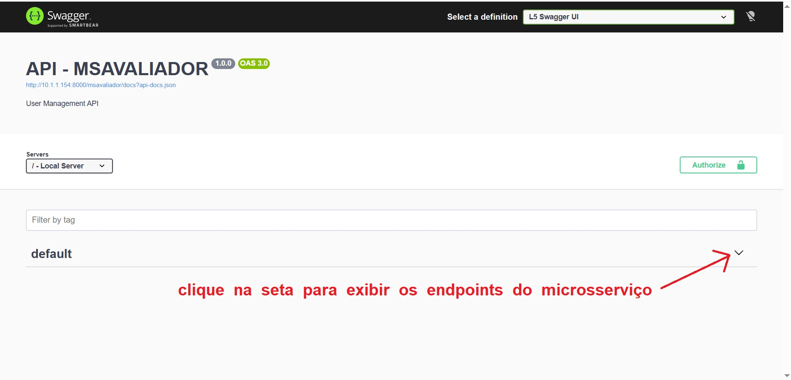<hr>
Tela exibindo todos os endpoints* de cada microsserviço<br><br>
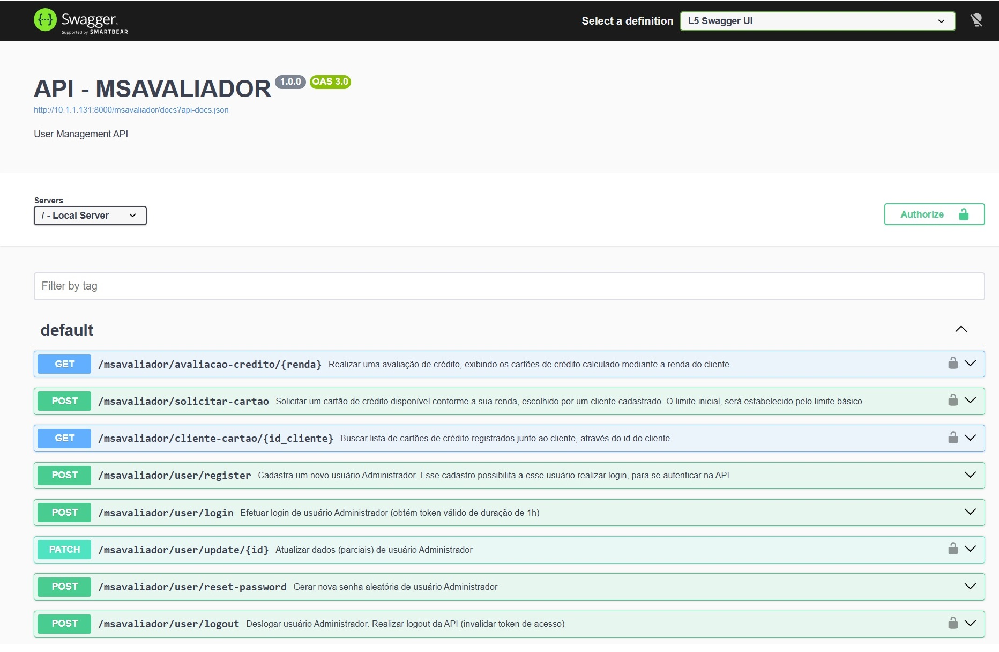
<b>NOTA<sup>endpoints</sup>: </b> Alguns endpoints responsáveis pela comunicação interna entre os microsserviços, não estão habilitados na documentação do <i>Swagger UI</i> para uso na API.<br><br>
Na codificação dos Controllers, acima desses métodos estarão comentados assim:<br>
`// acessado pelo MICROSSERVIÇO NOME_DO_MICROSSERVIÇO` indicando que se trata de um endpoint de uso exclusivo entre os microsserviços.<hr>
Por padrão, inicialmente, todos os endpoints estarão em modo leitura. Para habilitar o envio das requisições HTTP, é necessário clicar/apertar o botão <b>Try it out</b><br><br>
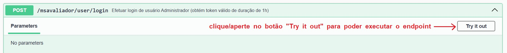
Em seguida, o endpoint libera o acesso, habilitando o botão <b>Execute</b><br><br>
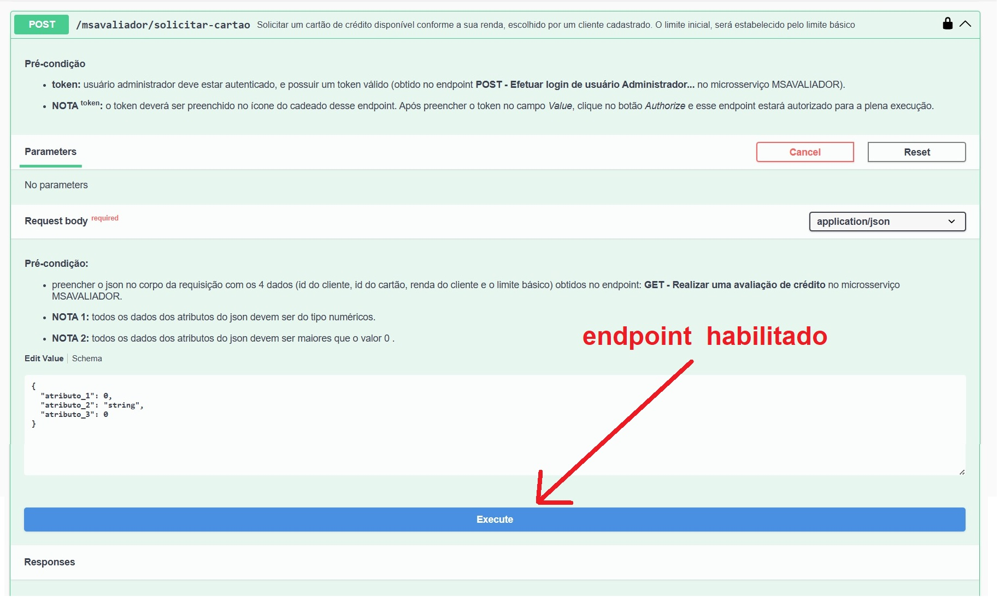<hr>
A interface do endpoint apresentada pelo <i>Swagger UI</i> possui alguns elementos-chave para o seu devido funcionamento:<br><br>
<b>verbo HTTP:</b> ação que o cliente realizará para acessar o endpoint da API<br>
<b>NOME_MICROSSERVIÇO/NOME_ENDPOINT:</b> identificação da URL do nome do microsserviço, seguido do nome do endpoint/recurso da API<br>
<b>descrição do objetivo do endpoint:</b> mostra o objetivo que esse endpoint irá realizar<br>
<b>ícone do cadeado do token:</b> esse ícone representa a autenticação e autorização de segurança mediante um token de acesso, necessário para acessar os endpoints (rotas) da API<br>
<b>Pré-condição:</b> condição que os atributos e parâmetros devem atender para que o endpoint possa processar sem que haja incidências de erros. Se houver alguma inconsistência, ou falha nas validações, a API retornará erros nas respostas<br>
<b>Parameters:</b> exibe os campos de entrada de dados que o endpoint exige em que o backend está configurado (são parâmetros que devem ser incluídos na URL da requisição)<br>
<b>Request body:</b> exibe a estrutura dos atributos que será enviada no corpo da requisição (objeto JSON) ao endpoint (são parâmetros que devem ser incluídos dentro da requisição)<br>
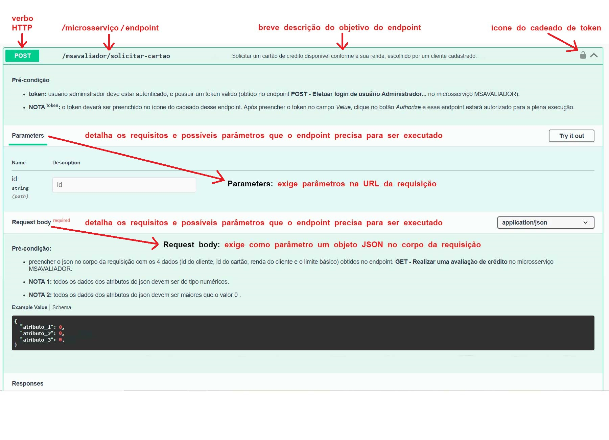<hr>
A imagem abaixo apresenta mais detalhes da interface do <i>Swagger UI:</i><br><br>
<b>Curl: </b>mostra a estrutura exata que deve conter no cabeçalho que uma requisição HTTP deve conter<br>
<b>Request URL: </b>indica o endereço web que será enviado do cliente à API<br>
<b>Server response: </b>área destinada para exibição de respostas da requisição HTTP<br>
<b>Code 500: </b>mostra o código de status HTTP retornado pela API do processamento da requisição<br>
<b>Response body: </b>exibe a estrutura que virá como resposta no corpo da requisição (dados que o frontend irá consumir)<br>
<b>Response headers: </b>contém os cabeçalhos de resposta retornada pela API<br><br>
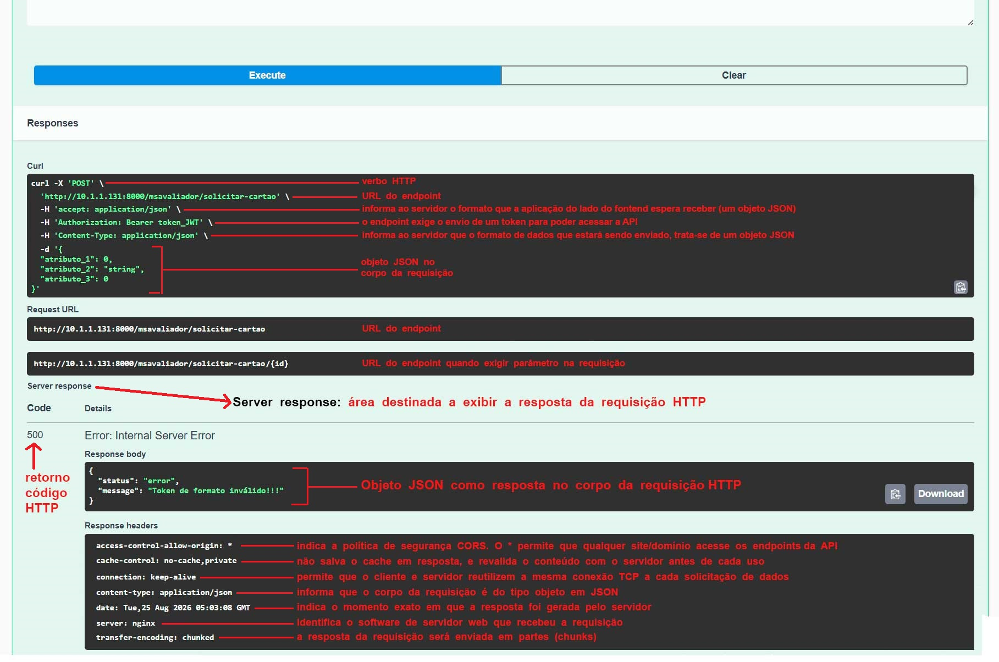<hr>
A imagem abaixo mostra a seção de uma resposta da requisição HTTP<br><br>
<b>Responses: </b>seção que exibe as saídas dos modelos de resposta da requisição HTTP<br>
<b>Code 202: </b>mostra o código de status HTTP retornado pela API do processamento da requisição<br>
<b>Pós-condição: </b>descreve o resultado final do processamento executado com êxito da requisição<br>
<b>Example Value: </b>exibe um exemplo de retorno dos dados contidos no corpo da requisição<br><br>
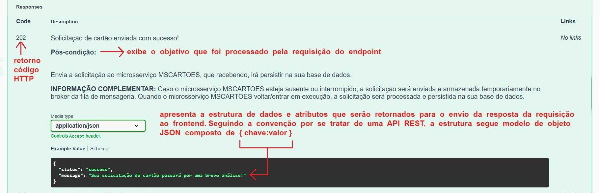<hr>
O endpoint também mostrará possíveis erros que a API enviará como resposta ao frontend:<br><br>
<b>Code 500: </b>mostra o código de status HTTP retornado pela API do processamento da requisição<br>
<b>Example Value: </b>mostra um exemplo de retorno dos dados contidos no corpo da requisição<br><br>
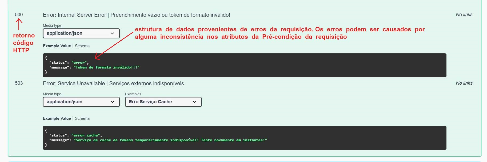<hr>
Outro tipo de erro que a API poderá retornar, são erros de validação em que as condições ou exigências dos dados da requisição daquele endpoint, não serão aceitas. 
Você poderá visualizar esses possíveis erros de validação dos dados da requisição, na caixa de opções <i>Examples</i><br><br>
<b>Code 422: </b>mostra o código de status HTTP retornado pela API do processamento da requisição<br>
<b>Examples: </b>mostra uma caixa de seleção em HTML, exibindo cada atributo do objeto JSON presente em cada requisição HTTP do backend para o frontend<br>
<b>Example Value: </b>exibe os erros de validação de cada erro que aquele atributo possa ocasionar. Essas mensagens de erros, serão retornadas no corpo da requisição na resposta da API<br><br>
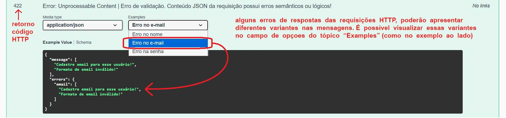<hr>
Área de inserção do token JWT<br><br>
<b>Cadeado aberto na cor cinza: </b>indica que esse endpoint está protegido, e exige autenticação por token JWT. A cor cinza significa que o campo de inserção está vazio<br><br>
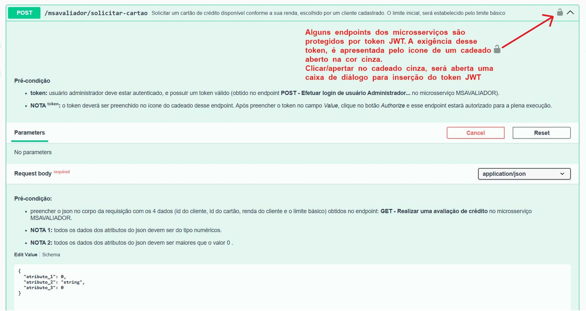<br><hr>
Passo-a-passo de inserção do token JWT<br><br>
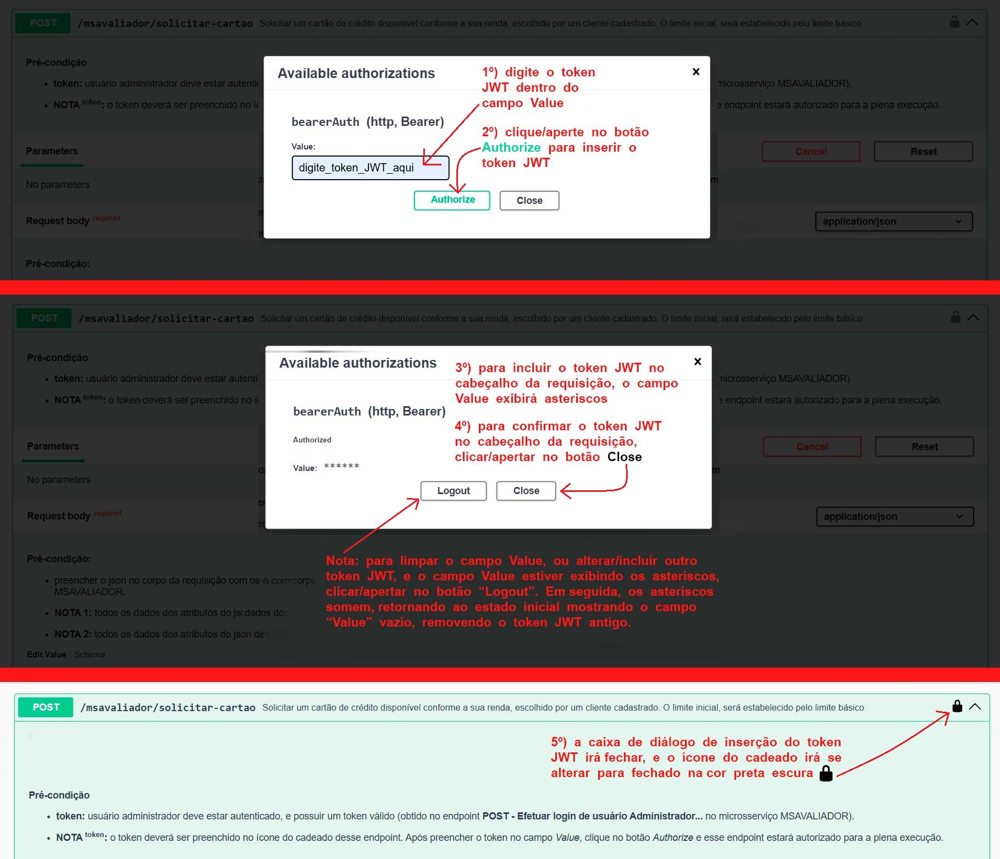<br><hr>
O link Schema detalha os tipos de dados suportados pelos atributos do objeto JSON<br><br>
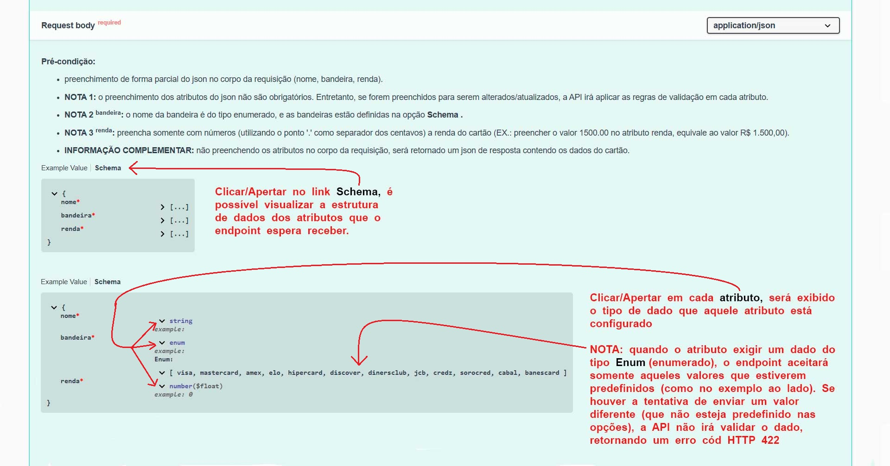
# Lógica dos Endpoints
## Realizar uma Avaliação de Crédito
Os parâmetros e os atributos dos objetos JSON, estão discriminados na documentação do <i>Swagger UI</i> de todos os endpoints dos Microsserviços.<br>
Para realizar as avaliações de crédito, é necessário antes cadastrar os cartões de crédito/bancos e os clientes na API.<br><br>
<b>1º)</b> Você deve cadastrar um usuário Administrador, acessando o Microsserviço MSAVALIADOR, e o endpoint <b>register</b><br><br>
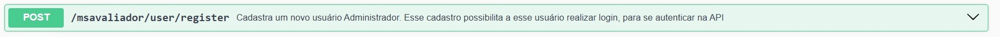<hr>
<b>2º)</b> Em seguida, você precisa realizar login com algum usuário Administrador que esteja cadastrado. Quando o usuário Administrador efetua o login, a API retorna uma resposta de confirmaçao de autenticação fornecendo um token JWT de acesso. Esse token serve para acessar as rotas que estão protegidas nos microsserviços. Acessar o Microsserviço MSAVALIADOR, e o endpoint de <b>efetuar login</b><br><br>
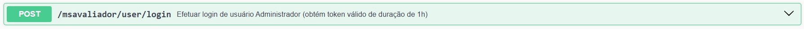<hr>
<b>3º)</b> Com o token obtido através da autenticação, você (como usuário Administrador) pode cadastrar os clientes e os cartões de crédito/bancos.<br>
Para cadastrar um cartão de crédito/banco, você deve inserir o token de acesso obtido na sua autenticação do endpoint login do microsserviço MSAVALIADOR (<i>para saber mais como inserir o token no endpoint, consulte a seção <b>Swagger UI (documentação)</b></i>).<br><br>
<b>NOTA 1: </b>A renda do cartão a ser cadastrada, refere-se a faixa de renda informada pelo cliente. Ex.: se houver cartões cadastrados, e nesse intervalo, tiver cartões com a faixa de renda no valor de R$ 4.000,00 e outros cartões com a faixa de renda no valor de R$ 3.500,00 , e no momento da avaliação de crédito, a renda informada do cliente for R$ 3.900,00 , a listagem de cartões que estarão disponíveis para esse cliente, retornará até o cartão de renda R$ 3.500,00.<br><br>
<b>NOTA 2: </b>É interessante você cadastrar várias opções de cartões de crédito, para que o seu cliente possa escolher qual cartão ele prefere.<br><br>
Acessar o Microsserviço MSCARTOES, e o endpoint de <b>cadastrar um cartão</b><br><br>
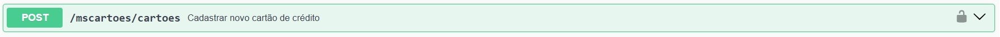<hr>
<b>4º)</b> Para cadastrar um cliente, você deve inserir o token de acesso obtido na sua autenticação do endpoint login do microsserviço MSAVALIADOR. Acessar o Microsserviço MSCLIENTES, e o endpoint de <b>cadastrar um cliente</b><br><br>
<hr>
<b>5º)</b> Com o cliente e os cartões cadastrados, torna-se habilitada a operação de realizar uma avaliação de crédito de algum cliente.<br><br>
<b>NOTA 1: </b>Para executar esse endpoint, o CPF a ser informado do cliente precisa estar cadastrado, e a renda do cliente é livre (ou seja, a renda não precisa estar previamente cadastrada).<br><br>
<b>NOTA 2: </b>Esse endpoint irá processar a avaliação de crédito, comparando a renda do cliente com as faixas de renda dos cartões de crédito. Definido os cartões de crédito que se enquadram dentro da renda do cliente, será efetuado cálculos com a renda e com a idade do cliente, para compor o valor de limite básico (limite inicial) estipulado dos cartões para aquele cliente<br><br>
<b>NOTA 3: </b>Esse endpoint retornará uma lista de cartões disponíveis ao clientes. Em seguida, o cliente deverá escolher qual o cartão de sua preferência dentre os cartões que forma retornados da lista. Você deve anotar/armazenar os dados do cartão que ele escolher, para executar o endpoint de <i>Solicitar Cartão</i><br>
<b>id do cliente ("id")<br>
id do cartão ("id")<br>
limite básico inicial ("limiteBasico")</b><br><br>
Acessar o Microsserviço MSAVALIADOR, e o endpoint de <b>realizar uma avaliação de crédito</b><br><br>
<hr>
<b>6º)</b> Após realizada a avaliação de crédito com o cliente no endpoint de avaliação de crédito,</b> dentre a lista de cartões retornados, o cliente deverá escolher 1 cartão. Esse cartão escolhido por ele (o cliente), o usuário Administrador (você) terá que informar os 4 dados que são exigidos por esse endpoint de <i>Solicitar Cartão:</i><br><br>
<b>id do cliente;</b><br>
<b>id do cartão escolhido pelo cliente;</b><br>
<b>renda informada pelo cliente no endpoint de <i>realizar uma avaliação de crédito</i></b><br>
<b>valor do limite básico inicial desse cartão</b><br><br>
Acessar o Microsserviço MSAVALIADOR, e o endpoint de <b>solicitar um cartão de crédto disponível ...</b><br><br>
<hr>
<b>NOTA: </b>é possível acessar os endpoints das rotas acima através de ferramentas que simulam envio e respostas das requisições HTTP como Insomnia e Postman.
O <i>Swagger UI</i> foi configurado nos endpoints, por ser intuitivo e fácil interação através da sua interface visual. Também pela praticidade em ser executado no próprio navegador, e ter incluída a documentação em cada endpoint (Pré-condição, Pós-condição, exemplos de envio e resposta das requisições HTTP).
# Informações Complementares
No momento de inicialização dos microsserviços, os containers de outros serviços estarão prontos para sua plena execução. As credenciais de acesso aos serviços estarão configuradas com valores padrão no arquivo <b>`.env.example`</b> dentro de cada microsserviço<br><br>
<b>Modo de Operação dos Containers:</b><br>
- Parar todos os containers, copie e cole o comando abaixo:
```
sudo docker compose stop
```
<b>NOTA: </b>para reinicializar todos os containers que foram parados, você pode digitar 2 comandos abaixo:
```
sudo sh start.sh
```
ou
```
sudo docker compose start
```
-------------------------------------------------
- Parar e apagar todos os containers, copie e cole o comando abaixo:
```
sudo docker compose down
```
<b>NOTA: </b>para gerar novamente os containers que foram apagados, pode digitar os 2 comandos abaixo:<br>
```
sudo sh start.sh
```
ou
```
sudo docker compose up -d
```
-------------------------------------------------
<b>NOTA: </b>caso o o arquivo .env seja apagado, execute novamente o comando (copie e cole)
```
sudo sh start.sh
```
Esse script irá gerar outro arquivo de configuração .env baseado no arquivo .env.example<br>
<hr>
<b>NOTA: </b> caso o arquivo .env.example seja apagado, você deverá clonar novamente o projeto do repositório do Git Hub, e executar o passo-a-passo no tópico <b>Instalação</b>
<hr>
<b>NOTA: </b> Seguindo o conceito de API/REST, ela não possui um frontend padrão (interface gráfica como telas, botões ou páginas web). O funcionamento da API basicamente resume-se a receber as requisições HTTP, processar a lógica no servidor, 
interagir com o banco de dados e, devolver uma resposta limpa (em formato JSON). A interface do <i>Swagger UI</i> serve apenas para mostrar a estrutura das requisições que os endpoints dos microsserviços estão configurados esperando em receber. 
Como citado nos tópicos anteriores, o <i>Swagger UI</i> possui a mesma funcionalidade de outras ferramentas de envios e recebimentos de requisições (Clientes HTTP como Insomnia e Postman).<br>
Abaixo, segue uma demonstração de como uma requisição HTTP deve ser elaborada e enviada utilizando a função nativa do JavaScript <i>Fetch API</i><br><br>
<b>Cadastrar Usuário Administrador no microsserviço MSAVALIADOR</b>

```javascript
// utiliza uma função assíncrona em JavaScript
async function criarUsuarioAdmin() {

    // objeto literal que deve ser enviado dentro do corpo da requisição HTTP (chave: valor)
    let obj = {
        'name': 'admin',
        'email': 'admin@email.com',
        'password': '12345'
    }
        
    // elaboração e envio da requisição HTTP ao endpoint Cadastrar Usuário Administrador
    const resposta = await fetch('http://localhost:8000/msavaliador/user/register', { 
        method: 'POST',
        body: JSON.stringify(obj),
        headers: {
            'Content-type': 'application/json'
        } 
    })

    // Tratando respostas baseadas nos códigos HTTP específicos desse endpoint
    if(resposta.status === 201) {
        const dados = await resposta.json()
        console.log(`Mensagem: ${dados.message}`)
        console.log(`Nome Usuário Adm cadastrado: ${dados.user.name}`)
        console.log(`Email Usuário Adm cadastrado: ${dados.user.email}`)
    }
    else if(resposta.status === 409) {
        const dado = await resposta.json()
        console.log(`Mensagem: ${dado.message}`)
    }
    else if(resposta.status === 422) {
        const dado = await resposta.json()
        console.log(`Mensagem: ${dado.message}`)
    }
    else if(resposta.status === 503) {
        const dado = await resposta.json()
        console.log(`Mensagem: ${dado.message}`)
    }
}
```
<b>Atualizar dados do Usuário Administrador no microsserviço MSAVALIADOR c/ envio de token e um parâmetro na URL da requisição</b>
```javascript
// utiliza uma função assíncrona em JavaScript
async function atualizarUsuarioAdm() {

    // variável que será enviado como parâmetro na URL da requisição
    let id = 1

    // informar token JWT obtido do endpoint de realizar login no microsserviço MSAVALIADOR (token exemplo)
    let tokenJWT = 'eXAiOitoken_invalidoJaWMxIiwitoken_invalidoiI6IjIzY.eyJpc3Mtoken_invalidoEzMTo4MDAwL21zYtoken_invalidoXZhbGlhZG9token_invalidoiLCJpYtoken_invalidoXQiOjE3OmNjAwYWRtoken_invalidoZjcifQ.6VPlGT5nJ5nfew83Atoken_invalido43CLV3FNGHptoken_invalidoL1XH0qnsje-RiGk'

    // objeto literal que deve ser enviado dentro do corpo da requisição HTTP (chave: valor)
    let obj = {
        'name': '',
        'email': '',
        'password': ''
    }

    // elaboração e envio da requisição HTTP ao endpoint Cadastrar Usuário Administrador
    const resposta = await fetch(`http://localhost:8000/msavaliador/user/update/${id}`, { 
        method: 'PATCH',
        body: JSON.stringify(obj),
        headers: {
            'Content-type': 'application/json',
            'Authorization': `Bearer ${tokenJWT}` // inclusão do token JWT
        } 
    });

    // Tratando respostas baseadas nos códigos HTTP específicos desse endpoint
    if(resposta.status === 200) {
        const dados = await resposta.json()
        console.log(`Status: ${dados.status}`)
        console.log(`ID usuário Adm: ${dados.user.id}`)
        console.log(`Nome Usuário Adm: ${dados.user.name}`)
        console.log(`Email Usuário Adm: ${dados.user.email}`)
    }
    else if(resposta.status === 400) {
        const dado = await resposta.json()
        console.log(`Mensagem: ${dado.message}`)
    }
    else if(resposta.status === 401) {
        const dado = await resposta.json()
        console.log(`Mensagem: ${dado.message}`)
    }
    else if(resposta.status === 404) {
        const dado = await resposta.json()
        console.log(`Mensagem: ${dado.message}`)
    }
    else if(resposta.status === 409) {
        const dado = await resposta.json()
        console.log(`Mensagem: ${dado.message}`)
    }
    else if(resposta.status === 422) {
        const dado = await resposta.json()
        console.log(`Mensagem: ${dado.message}`)
    }
    else if(resposta.status === 500) {
        const dado = await resposta.json()
        console.log(`Mensagem: ${dado.message}`)
    }
    else if(resposta.status === 503) {
        const dado = await resposta.json()
        console.log(`Mensagem: ${dado.message}`)
    }
}
```
## Contato para dúvidas ou sugestões
E-mail: medrina@gmail.com<br>
c/ Rafael Martins
